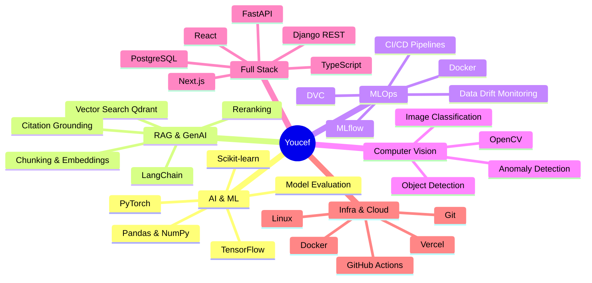
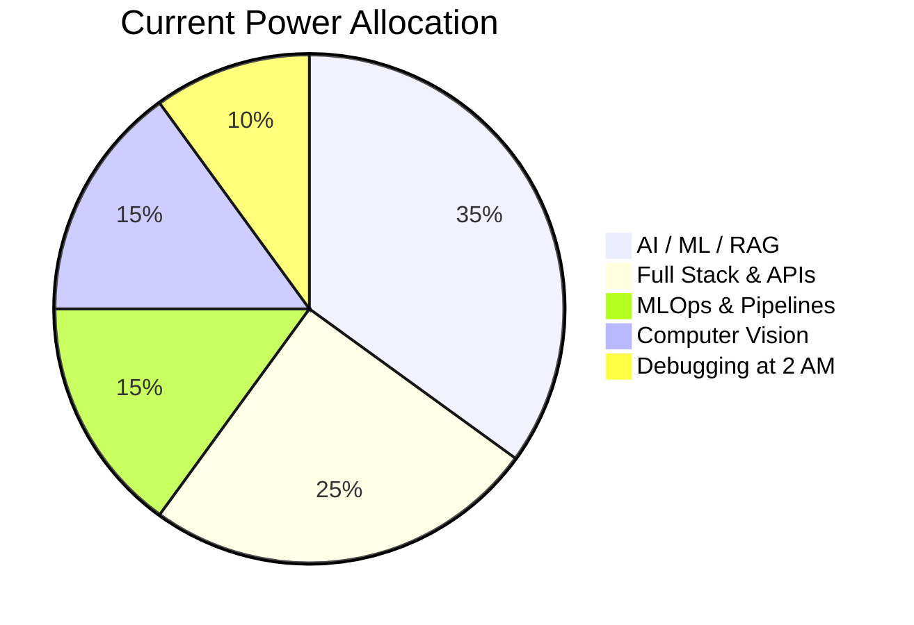

<div align="center">


[](https://git.io/typing-svg)


</div>

---

<div align="center">

## 🐍 Snake Game Repo View

<picture>
  <source
    media="(prefers-color-scheme: dark)"
    srcset="https://raw.githubusercontent.com/youcefamar/youcefamar/output/github-contribution-grid-snake-dark.svg?v=5"
  />
  <source
    media="(prefers-color-scheme: light)"
    srcset="https://raw.githubusercontent.com/youcefamar/youcefamar/output/github-contribution-grid-snake.svg?v=5"
  />
  
</picture>

</div>


## 🎮 Player Card

<table>
<tr>
<td width="50%">

### ⚔️ Identity Loadout

| Attribute | Value |
|---|---|
| 🧑‍💻 **Player** | Youcef Amar |
| 🏷️ **Class** | AI/ML Engineer + Full Stack Developer |
| 🧙 **Subclass** | RAG Architect / MLOps & GenAI Summoner |
| ⚔️ **Weapons** | Python, FastAPI, PyTorch, React, TypeScript |
| 🛡️ **Armor** | Docker, CI/CD, GitHub Actions, Linux, Logs |
| 🧟 **Enemies** | Hallucinations, CUDA OOM, Data Drift, 500 Errors |

</td>
<td width="50%">

### 🔥 Live Status

```text
YOUCEF.EXE initialized
HP:       ██████████ 100%
AI / ML:  █████████░  90%
RAG / LLM:█████████░  90%
MLOps:    ████████░░  85%
Fullstack:█████████░  90%
Sleep:    ██░░░░░░░░  20%
Grass:    █░░░░░░░░░  10%
```

</td>
</tr>
</table>

---

## 🧙‍♂️ About Me


Hey, I’m **Youcef** — an **AI/ML Engineer** and **Full Stack Developer** focused on building intelligent decision-support systems, **RAG document pipelines**, **Computer Vision**, **MLOps & CI/CD workflows**, and **scalable Web/Mobile Applications**.

I build projects that start as *“this idea is insane”* and somehow become *“wait, this actually works.”*

The model hallucinates. The backend panics. The frontend shifts by 2 pixels for no reason. The database silently judges everyone.

And yet... **we ship.** 🚀

<br clear="right" />

<div align="center">

[](https://www.linkedin.com/in/youcef-amar/)
[](mailto:youcefamar100@gmail.com)
[](https://github.com/youcefamar)

</div>


<div align="center">

## 🧰 Inventory / Tech Stack

[](https://git.io/typing-svg)

### 🗡️ Languages

<br/><br/>


### 🧩 Frameworks & Libraries

<br/><br/>


### 🤖 AI / ML / Computer Vision & GenAI

<br/><br/>


### 🏰 Databases / Cloud / Tools / MLOps

<br/><br/>


</div>


<div align="center">

## 📊 GitHub Battle Stats

<a href="https://github.com/youcefamar">
  
</a>
<a href="https://github.com/youcefamar">
  
</a>

<br/><br/>

<a href="https://github.com/youcefamar/docMind">
  
</a>
<a href="https://github.com/youcefamar/cicd-ml">
  
</a>

<br/><br/>


<br/><br/>


</div>

---

## 🕹️ Class Selection Screen

| Class | Role | Passive Ability | Ultimate |
|---|---|---|---|
| 🧙 **RAG Wizard** | Document intelligence | Extracts truth from PDFs & vector stores | `Citation Storm` |
| 🤖 **Agentic AI Summoner** | Tool-using AI workflows | Automates repetitive cognitive loops | `Multi-Agent Swarm` |
| 👁️ **Computer Vision Hunter** | Pixel analysis & defect detection | Spots anomalies in the wild | `Frame-by-Frame Judgment` |
| 🛡️ **Full Stack Tank** | Product engineering | Carries frontend + backend + database | `Deploy Without Fear` |
| 🧪 **MLOps Alchemist** | Pipeline automation & drift tracking | Turns raw data into reproducible models | `Continuous Retraining Ritual` |

---

## 🧠 Skill Tree



---

## 📊 Brain Power Distribution



---

## 🧾 Quest Log

| Quest | Status |
|---|---|
| Build full-stack AI applications | ✅ Completed |
| Architect end-to-end RAG pipelines | ✅ Completed |
| Build automated MLOps & CI/CD workflows | ✅ Completed |
| Deploy intelligent agentic systems | 🟩 Active |
| Train computer vision anomaly detectors | 🟩 Active |
| Optimize low-latency vector retrieval | 🟨 In Progress |
| Defeat flaky dependencies & CUDA mismatch | ♾️ Eternal Quest |
| Touch grass | ❌ Optional DLC |


## 🎮 Interactive Mini Game: Debug Boss Fight

<details>
<summary>🟢 <b>Level 1: API returns 500. Choose your move.</b></summary>

```text
A) Refresh repeatedly and hope
B) Blame the frontend
C) Check logs like a responsible engineer
```

✅ Correct: **C**  
Reward: `+10 sanity`, `+1 backend mastery`, `500 error took emotional damage`
</details>

<details>
<summary>🟡 <b>Level 2: RAG output is hallucinating. Choose your spell.</b></summary>

```text
A) Increase temperature because chaos is art
B) Improve chunking, retrieval, reranking, and context grounding
C) Tell users "it's a feature"
```

✅ Correct: **B**  
Reward: `+20 truthfulness`, `+15 retrieval accuracy`, `hallucination debuffed`
</details>

<details>
<summary>🔴 <b>Level 3: Production broke at 2 AM. Final boss music starts.</b></summary>

```text
Boss: NullPointerDragon
HP: 9999
Weakness: stack traces
```

Move sequence: `logs → reproduce → root cause → patch → test → deploy → pretend calm`  
🏆 Victory unlocked: **Production Survivor**
</details>

<details>
<summary>🟣 <b>Secret Level: The model works locally but fails in deployment.</b></summary>

```text
Possible causes:
- Missing environment variable
- Wrong model path or CUDA driver mismatch
- Container memory limit
- Dependency mismatch between torch and torchvision
- The cloud simply woke up and chose violence
```

Reward: `+30 DevOps XP`, `+1 thousand-yard stare`
</details>

---

## 🏆 Achievement Unlocked

| Achievement | Description |
|---|---|
| 🧙 RAG Wizard | Built retrieval-augmented generation systems |
| ⚔️ API Knight | Survived high-concurrency REST API battles |
| 🐉 Bug Slayer | Defeated errors that had no business existing |
| 🧠 Tensor Tamer | Trained and fine-tuned models without losing sanity |
| 🏗️ Full Stack Builder | Built apps from database schema to modern UI |
| 🚀 Ship Happens | Deployed projects despite the universe resisting |
| 🕵️ Log Detective | Found bugs through terminal archaeology |
| 🔥 Overengineering Enjoyer | Made the architecture 3x cooler than required |

---

<div align="center">

## 🧿 Developer Mood Board


</div>
